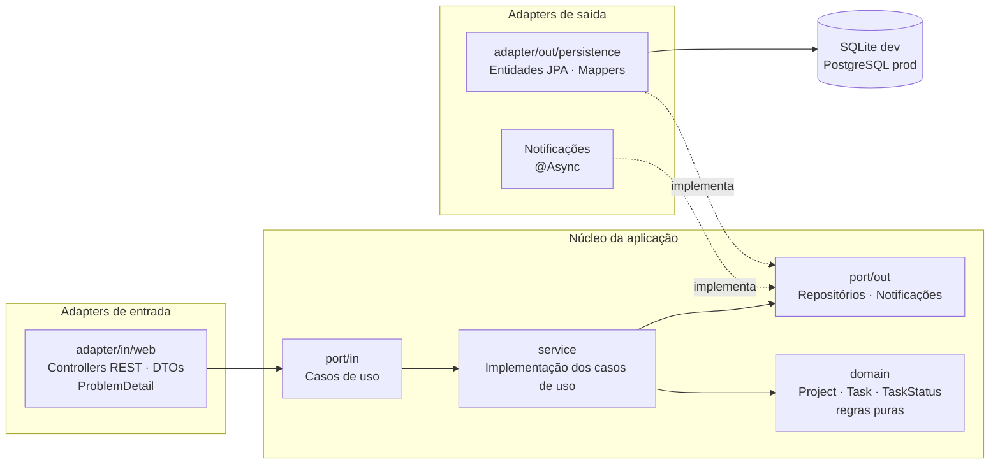
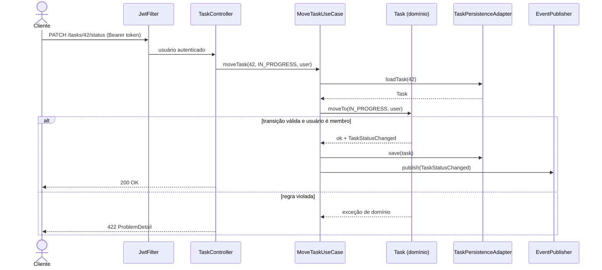
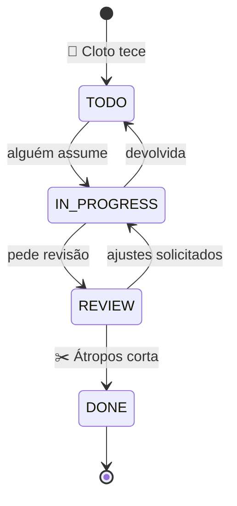

<div align="center">


# ♾ Moirai
### Tecer, medir e cortar o fio de cada tarefa

**API REST de gestão de projetos e tarefas (estilo Kanban) com Spring Boot 4 e Arquitetura Hexagonal.**
Domínio isolado do framework, segurança com JWT, autorização por recurso, eventos assíncronos,<br/>
cache, observabilidade e testes em todas as camadas, do domínio puro à API completa.

[](https://github.com/GustavoThe01/moirai-taskflow/actions/workflows/ci.yml)


</div>

---

## 👨‍💻 Autor

<table>
  <tr>
    <td width="62%">

Eu sou o **Gustavo Osterno Thé**, e a **Moirai** é um dos cinco projetos do meu portfólio público de Desenvolvedor Pleno. Idealizei, desenvolvo e mantenho este repositório.

No [Nidavellir](https://github.com/GustavoThe01/nidavellir-inventory) eu construo tudo à mão; aqui o desafio é outro: **usar o Spring sem deixar o Spring tomar conta do domínio**. Planejei a API para ficar pronta para produção em 4 semanas, com segurança, Docker e observabilidade.

    </td>
    <td width="38%">

| | |
|---|---|
| 🌐 Site | [site-gustavothe-dev.web.app](https://site-gustavothe-dev.web.app/) |
| 💼 LinkedIn | [gustavoosterno](https://www.linkedin.com/in/gustavoosterno/) |
| 🐙 GitHub | [@GustavoThe01](https://github.com/GustavoThe01) |
| 📸 Instagram | [@gustavo.osterno](https://www.instagram.com/gustavo.osterno) |

    </td>
  </tr>
</table>

---

## 📑 Sumário

- [Em números](#-em-números)
- [A origem do nome](#-a-origem-do-nome)
- [O que a API faz](#-o-que-a-api-faz)
- [Endpoints planejados](#-endpoints-planejados)
- [Arquitetura Hexagonal](#️-arquitetura-hexagonal)
- [O ciclo de vida de uma tarefa](#-o-ciclo-de-vida-de-uma-tarefa)
- [Segurança](#-segurança)
- [N+1: encontrado, medido e corrigido](#-n1-encontrado-medido-e-corrigido)
- [Auditoria e exclusão lógica](#️-auditoria-e-exclusão-lógica)
- [Competências demonstradas](#-competências-demonstradas)
- [Metodologias e decisões](#-metodologias-e-decisões)
- [Roadmap](#️-roadmap)
- [Como rodar](#-como-rodar)
- [Testes](#-testes)
- [Estrutura do projeto](#-estrutura-do-projeto)
- [O que ainda falta](#-o-que-ainda-falta)
- [Projetos relacionados](#-projetos-relacionados)

---

## 📊 Em números

<div align="center">

| 🌐 API | 🏛️ Arquitetura | 🛡️ Produção | 🗓️ Processo |
|:---:|:---:|:---:|:---:|
| **16** endpoints planejados | Hexagonal (Ports & Adapters) | JWT access + refresh | **20** dias / **4** semanas |
| ProblemDetail (RFC 9457) | domínio **sem** Spring/JPA | cache · rate limiting | **3** ADRs registrados |
| OpenAPI / Swagger | regra verificada com ArchUnit | Docker · métricas · logs JSON | **4** releases (`v0.1` → `v1.0`) |

<sub>Metas para o fim do roadmap. O estado atual está nos badges, na seção <a href="#-testes">Testes</a> e em <a href="#-o-que-ainda-falta">O que ainda falta</a>.</sub>

</div>

---

## ♾ A origem do nome

> *Na mitologia grega, as Moiras eram três irmãs que controlavam o fio da vida: Cloto o tecia, Láquesis o media e Átropos o cortava.*

Escolhi o nome porque toda tarefa tem o mesmo destino: ela **nasce** (é criada), **é medida** (está em andamento, tem prazo e responsável) e **é cortada** (é concluída). A Moirai é a API que tece esse fio e garante que nenhuma tarefa pule etapas do seu destino.

| Moira | Papel no mito | Papel na API |
|---|---|---|
| 🧵 **Cloto** | Tece o fio | `TODO` — a tarefa é criada |
| 📏 **Láquesis** | Mede o fio | `IN_PROGRESS` / `REVIEW` — prazo, responsável, revisão |
| ✂️ **Átropos** | Corta o fio | `DONE` — a tarefa é encerrada |

---

## ✨ O que a API faz

| Módulo | O que resolve |
|---|---|
| 👤 **Usuários** | Cadastro, login com senha BCrypt e tokens JWT (access + refresh) |
| 📁 **Projetos** | Criação, membros e permissões: só quem participa enxerga o projeto |
| ✅ **Tarefas** | Criação, atribuição, prioridade, prazo e **máquina de estados** |
| 🏷️ **Labels** | Etiquetas reutilizáveis (relação N:N com tarefas) |
| 💬 **Comentários** | Discussão dentro de cada tarefa |
| 🔎 **Busca** | Paginação, ordenação e filtros dinâmicos (status, responsável, prazo) |
| 🕵️ **Auditoria** | Quem e quando criou ou alterou cada projeto e tarefa; projeto excluído continua no banco (exclusão lógica) |
| 🔔 **Eventos** | Mudança de status dispara notificação assíncrona |
| 📈 **Operação** | Health check, métricas, logs estruturados e correlation id |

---

## 🌐 Endpoints planejados

| Método | Rota | Descrição | Dia |
|---|---|---|:---:|
| `GET` | `/actuator/health` | Saúde da aplicação | ✅ 01 |
| `POST` | `/api/v1/auth/register` | Cadastro de usuário | ✅ 11 |
| `POST` | `/api/v1/auth/login` | Login: devolve access token (JWT) e refresh token | ✅ 11 · tokens no 12 |
| `POST` | `/api/v1/auth/refresh` | Troca o refresh token por um par novo (rotação) | ✅ 12 |
| `POST` | `/api/v1/auth/logout` | Revoga o refresh token da sessão | ✅ 12 |
| `GET` | `/api/v1/admin/users` | Lista os usuários, só papel `ADMIN` | ✅ 12 |
| `GET` | `/api/v1/projects` | Lista projetos do usuário | ✅ 04 |
| `POST` | `/api/v1/projects` | Cria projeto | ✅ 04 |
| `GET` | `/api/v1/projects/{id}` | Detalhe do projeto | ✅ 04 |
| `PUT` | `/api/v1/projects/{id}` | Renomeia o projeto (só o dono) | ✅ 04 |
| `DELETE` | `/api/v1/projects/{id}` | Exclui o projeto (só o dono); exclusão lógica desde o Dia 10 | ✅ 04 |
| `GET` | `/api/v1/projects/{id}/members` | Lista os membros, com nome e e-mail | ✅ 13 |
| `POST` | `/api/v1/projects/{id}/members` | Adiciona membro pelo e-mail (só o dono) | ✅ 13 |
| `DELETE` | `/api/v1/projects/{id}/members/{userId}` | Remove membro (só o dono; o dono não sai) | ✅ 13 |
| `GET` | `/api/v1/projects/{id}/tasks` | Lista tarefas com filtros, ordenação e paginação | ✅ 06 |
| `POST` | `/api/v1/projects/{id}/tasks` | Cria tarefa | ✅ 05 |
| `PATCH` | `/api/v1/tasks/{id}/status` | Move a tarefa no fluxo | ✅ 05 |
| `PATCH` | `/api/v1/tasks/{id}/assignee` | Atribui responsável | ✅ 05 |
| `POST` | `/api/v1/projects/{id}/labels` | Cria etiqueta no projeto | ✅ 09 |
| `GET` | `/api/v1/projects/{id}/labels` | Lista as etiquetas do projeto | ✅ 09 |
| `PUT` | `/api/v1/tasks/{id}/labels` | Troca as etiquetas da tarefa (N:N) | ✅ 09 |
| `POST` | `/api/v1/tasks/{id}/comments` | Comenta na tarefa | ✅ 09 |
| `GET` | `/api/v1/tasks/{id}/comments` | Lista os comentários da tarefa | ✅ 09 |

> Menos as rotas de autenticação, toda rota exige o access token no cabeçalho `Authorization: Bearer <token>`. Deixei exemplos de todas as chamadas, começando pelo login, em [`requests.http`](requests.http).

Exemplo de erro padronizado (**ProblemDetail, RFC 9457**):

```json
{
  "type": "/problems/invalid-transition",
  "title": "Transição de status inválida",
  "status": 422,
  "detail": "Uma tarefa em TODO não pode ir para DONE.",
  "instance": "/api/v1/tasks/42/status"
}
```

---

## 🏛️ Arquitetura Hexagonal

O domínio fica no centro e **não conhece Spring, JPA nem HTTP**. O mundo externo conversa com ele por **portas** (interfaces) e **adaptadores** (implementações). Registrei essa decisão no [ADR 0001](docs/adr/0001-arquitetura-hexagonal.md).



> 🔄 **A prova da arquitetura:** no Dia 15, vou trocar o banco de produção de SQLite para PostgreSQL **mexendo apenas no adapter de persistência**, sem tocar em domínio nem em casos de uso.

### Por dentro de uma requisição



---

## 🔄 O ciclo de vida de uma tarefa



---

## 🔐 Segurança

| Camada | Como |
|---|---|
| **Senhas** | BCrypt, nunca em texto puro ✅ |
| **Autenticação** | JWT de curta duração (access) + refresh token ✅ |
| **Autorização** | Por papel (`USER`, `ADMIN`) e **por recurso**: só membros acessam o projeto ✅ |
| **Erros** | `401` sem token válido, `403` sem permissão, sem vazar detalhes internos |
| **Segredos** | Variáveis de ambiente por profile (`dev`, `test`, `prod`), nada no repositório |
| **Abuso** | Rate limiting por usuário (Bucket4j) |

### O que já está pronto (Dia 11)

**Cadastro e login.** `POST /api/v1/auth/register` cria a conta e `POST /api/v1/auth/login` confere e-mail e senha.
O e-mail é gravado em minúsculas e é único (índice único na tabela `app_user`). A senha só existe em texto puro dentro
da requisição: o banco guarda o hash BCrypt, que já carrega o sal e o custo (`$2a$10$...`).

**BCrypt fora do domínio.** O domínio (`User`) guarda o hash como um texto opaco. Quem gera e confere é a porta
`PasswordHasher`, implementada por [`BCryptPasswordHasher`](src/main/java/dev/gustavo/moirai/adapter/out/security/BCryptPasswordHasher.java)
com o `BCryptPasswordEncoder` do Spring Security. O caso de uso é testado com um mock dessa porta, sem Spring.

Decisões de segurança que tomei no login:

- **Mesma resposta para os dois erros.** E-mail desconhecido e senha errada dão o mesmo `401` com a mesma mensagem,
  para a resposta não revelar quais e-mails têm conta.
- **Mesmo tempo para os dois erros.** Quando o e-mail não existe, o BCrypt roda mesmo assim, contra um hash qualquer.
  Sem isso, a resposta para e-mail desconhecido sairia dezenas de milissegundos mais rápida, e o tempo denunciaria a conta.
- **Limite de 72 bytes.** O BCrypt ignora o que passa de 72 bytes da senha, sem avisar. A API recusa senhas maiores
  em vez de aceitar uma senha que valeria só pela metade. São bytes e não caracteres: "ç" ocupa 2 bytes em UTF-8.
- **Senha fora dos logs.** Os DTOs de cadastro e login escondem a senha no `toString`, e o `User` esconde o hash.

**Spring Security, primeiro passo.** A [`SecurityConfig`](src/main/java/dev/gustavo/moirai/config/SecurityConfig.java)
monta a cadeia de filtros de uma API sem sessão: sem cookie, sem formulário de login, sem HTTP Basic e com CSRF
desligado (o CSRF protege sessões com cookie, que esta API não tem). As rotas públicas ficam declaradas.

### JWT: access token curto e refresh token com rotação (Dia 12)

O cabeçalho provisório `X-User-Id` saiu. Agora o login devolve dois tokens, e toda rota que não é de autenticação
exige o primeiro:

| | Access token | Refresh token |
|---|---|---|
| **O que é** | JWT assinado com HMAC-SHA256 (`sub` = id do usuário, `roles` = papel) | 32 bytes aleatórios em Base64 URL |
| **Validade** | 15 minutos | 7 dias, uso único |
| **Onde é conferido** | Só pela assinatura, emissor e validade, sem consultar o banco | No banco, pelo hash SHA-256 (o texto do token nunca é gravado) |
| **Para que serve** | Ir no cabeçalho `Authorization: Bearer` de cada requisição | Pedir um par novo em `POST /api/v1/auth/refresh` |

O Spring Security virou um **resource server**: o `NimbusJwtDecoder` confere cada token, e o claim `roles` vira as
autoridades `ROLE_USER` e `ROLE_ADMIN`. Nos controllers, o parâmetro [`@CurrentUser`](src/main/java/dev/gustavo/moirai/adapter/in/web/CurrentUser.java)
recebe o `sub` do token já como `UserId`, no lugar do cabeçalho. A auditoria lê o mesmo `sub`.

Decisões que tomei:

- **Por que dois tokens.** O access token não pode ser revogado: a API o aceita só pela assinatura, sem banco. Por isso
  ele dura 15 minutos. O refresh token fica no banco e pode ser revogado, e é ele que mantém a sessão por dias.
- **Rotação com detecção de reutilização.** Cada refresh troca o token usado por um novo, e o usado deixa de valer.
  Se um token já trocado aparecer de novo, alguém tem uma cópia dele: a API revoga todos os tokens daquele login
  (a família) e responde `401`. O dono legítimo só precisa fazer login de novo; quem copiou perde o acesso.
- **Só o hash no banco.** Com SHA-256, e não BCrypt: o token já tem 256 bits aleatórios, então não existe senha fraca
  para proteger contra força bruta, e o hash precisa ser determinístico para a busca pelo índice único.
- **Chave fora do repositório.** A chave HMAC vem de `moirai.security.jwt-secret` (Base64, pelo menos 32 bytes), por
  variável de ambiente. Sem ela, a aplicação gera uma chave temporária a cada execução e avisa no log; no Dia 14, o
  profile `prod` vai exigir a chave.
- **Papel `ADMIN` sem endpoint.** Quem é administrador é decidido por quem opera o sistema
  (`moirai.security.admin-emails`), e não por uma rota da API.
- **`401` × `403`.** Sem token, com token adulterado, vencido ou de outro emissor: `401` com `WWW-Authenticate: Bearer`.
  Com token válido sem o papel exigido: `403`. As duas respostas saem em ProblemDetail, como o resto da API.

**Mudança de plano: as chaves estrangeiras para `app_user`.** No Dia 11 escrevi que elas entrariam junto com o JWT.
Não entraram. No SQLite, acrescentar uma chave estrangeira exige recriar a tabela, e seriam cinco tabelas
(`project`, `project_member`, `task`, `comment` e `task_label`) só para depois recriar tudo de novo no PostgreSQL do
Dia 15. Elas entram na migração para o PostgreSQL, onde `ALTER TABLE ... ADD CONSTRAINT` funciona direto.

### Autorização por recurso: cada projeto com os seus membros (Dia 13)

Saber quem é a pessoa (o token) não basta: o que ela pode fazer depende do projeto. Há dois tipos de regra, e cada
um ficou num lugar diferente:

| Regra | Depende de | Onde fica | Exemplo |
|---|---|---|---|
| **Por papel** | Só do token | `@PreAuthorize("hasRole('ADMIN')")` no método do controller | `GET /api/v1/admin/users` |
| **Por recurso** | Do projeto (quem é dono, quem é membro) | No domínio, em `Project.requireMember` e `requireOwner`, chamados pelos casos de uso | Ver, renomear, excluir, criar tarefa, comentar |

Por que a regra de membro não virou `@PreAuthorize`: para saber se alguém é membro é preciso carregar o projeto, e
quem carrega o projeto é o caso de uso. Uma expressão no controller teria de buscar o projeto de novo, e a regra
ficaria espalhada entre a anotação e o domínio. Assim, o domínio continua sendo a única fonte da regra, e ela vale
para qualquer porta de entrada, inclusive uma que não seja HTTP.

**Membros.** O dono adiciona alguém pelo e-mail (a pessoa precisa ter conta), lista os membros e remove quem não
participa mais. Duas decisões:

- **A permissão vem antes da busca do e-mail.** Quem não é dono recebe `403` sem a API procurar o e-mail. Se a busca
  viesse antes, um `404` para "e-mail sem conta" revelaria a qualquer usuário quais e-mails têm conta.
- **O papel `ADMIN` não abre projetos.** Administrar o sistema (listar usuários) é diferente de participar de um
  projeto. Um administrador que não é membro recebe `403`, como qualquer pessoa.

**A matriz de segurança.** O [`ResourceAuthorizationTest`](src/test/java/dev/gustavo/moirai/adapter/in/web/ResourceAuthorizationTest.java)
usa usuários e tokens de verdade (cadastro e login pela API) e passa por todas as 14 rotas de um projeto duas vezes:
sem token, toda rota responde `401`; com o token de alguém que não é membro, toda rota responde `403`, e o teste
confere que o projeto e a tarefa continuam iguais. Uma rota nova que esquecer a verificação quebra o teste.

---

## 🐢 N+1: encontrado, medido e corrigido

Antes de corrigir, escrevi um teste que conta os comandos SQL pelas estatísticas do Hibernate. Ele mostrou dois casos:

| Consulta | Antes | Depois | Correção |
|---|---:|---:|---|
| Página de 20 tarefas com etiquetas | 22 comandos | 3 | `@BatchSize(size = 50)` na coleção |
| 15 projetos do usuário com os membros | 16 comandos | 1 | `@EntityGraph(attributePaths = "members")` |

O segundo existia desde o Dia 03 e passou despercebido: cada projeto da lista buscava os membros numa consulta própria.

As correções são diferentes de propósito. A lista de tarefas é paginada, e um `fetch join` de coleção com paginação faz
o Hibernate trazer tudo e paginar em memória. Com `@BatchSize`, ele busca as etiquetas das 20 tarefas da página de uma
vez, com `task_id IN (...)`. A lista de projetos não é paginada, então o `@EntityGraph` traz os membros na mesma consulta.

O teste fica no projeto ([`NPlusOneTest`](src/test/java/dev/gustavo/moirai/adapter/out/persistence/NPlusOneTest.java)):
se o N+1 voltar, o build quebra.

---

## 🕵️ Auditoria e exclusão lógica

Cada projeto guarda quem o criou e quando, e projetos e tarefas guardam quem fez a última alteração e quando.
Quem preenche essas colunas é o **JPA Auditing** do Spring Data, e não o código dos casos de uso:

| Peça | O que faz |
|---|---|
| [`AuditedEntity`](src/main/java/dev/gustavo/moirai/adapter/out/persistence/AuditedEntity.java) | `@MappedSuperclass` com `updated_at` e `updated_by`, herdada pelas entidades de projeto e tarefa |
| `@CreatedDate` / `@CreatedBy` | Só no projeto, com `updatable = false`: uma alteração nunca apaga quem criou |
| [`AuditingConfig`](src/main/java/dev/gustavo/moirai/config/AuditingConfig.java) | `AuditorAware` lê o usuário do access token (claim `sub`); `DateTimeProvider` usa o mesmo `Clock` da aplicação |

A auditoria ficou na camada de persistência de propósito: quem alterou e quando é um detalhe de armazenamento, e o
domínio continua sem nenhuma anotação do Spring ou do JPA. Fora de uma requisição (um teste, um job), não há usuário,
e as colunas `*_by` ficam vazias.

**Exclusão lógica.** O `DELETE` de um projeto só grava a data em `deleted_at`. A linha e as tarefas continuam no
banco, e `@SQLRestriction("deleted_at IS NULL")` na entidade faz todas as consultas da aplicação ignorarem o
projeto. Para a API, ele não existe mais: buscar, listar tarefas ou mudar uma tarefa dele devolve `404`. Excluir de
novo também devolve `404` e não muda a data da primeira exclusão.

Duas coisas que aprendi no caminho:

- A exclusão é um `UPDATE` nativo. Numa consulta JPQL de `UPDATE`, o Hibernate acrescenta o filtro do
  `@SQLRestriction` com um alias de tabela que o SQLite não aceita; com SQL nativo o comando fica exatamente como eu
  escrevi.
- As colunas de data da [`V4`](src/main/resources/db/migration/V4__audit_and_soft_delete.sql) são declaradas como
  `TIMESTAMP` porque a validação do schema (`ddl-auto: validate`) confere esse tipo. No SQLite o nome do tipo não
  muda o armazenamento, e o dialeto do Hibernate grava as datas como milissegundos desde 1970 (epoch). No
  PostgreSQL (Dia 15) a mesma coluna vira um `timestamp` de verdade.

O índice parcial `ix_project_active` cobre só os projetos não excluídos, que são os que a aplicação consulta.
Os quatro testes estão em [`AuditAndSoftDeleteTest`](src/test/java/dev/gustavo/moirai/adapter/out/persistence/AuditAndSoftDeleteTest.java).

---

## 🧠 Competências demonstradas

| Área | Conceitos |
|---|---|
| **Arquitetura** | Hexagonal, portas e adaptadores, separação domínio × JPA, mappers explícitos |
| **API REST** | Verbos e status corretos, paginação, filtros (Specifications), ProblemDetail, OpenAPI |
| **Persistência** | Spring Data JPA, Flyway, relacionamentos N:N, **problema N+1** e `@EntityGraph`, auditoria |
| **Segurança** | Spring Security, JWT, BCrypt, `@PreAuthorize`, autorização por recurso |
| **Assíncrono** | Eventos de domínio, `ApplicationEventPublisher`, `@Async` |
| **Performance** | Cache com Caffeine, rate limiting |
| **Observabilidade** | Logs JSON, correlation id (MDC), Micrometer, Actuator |
| **Testes** | Unitários puros, `@WebMvcTest`, `@DataJpaTest`, `@SpringBootTest`, ArchUnit |
| **DevOps** | Maven Wrapper, Docker multi-stage, docker-compose, GitHub Actions, SonarCloud |

---

## 🧭 Metodologias e decisões

- **Domínio primeiro**: escrevo as regras em Java puro e testo sem subir o Spring.
- **Roadmap diário público** com uma release por semana, registrado no [ROADMAP.md](ROADMAP.md).
- **Conventional Commits**, versionamento semântico e **ADRs**.

| ADR | Decisão | Status |
|---|---|---|
| [0001](docs/adr/0001-arquitetura-hexagonal.md) | Arquitetura Hexagonal (Ports & Adapters) | ✅ Aceita |
| [0002](docs/adr/0002-sqlite-em-desenvolvimento.md) | SQLite em desenvolvimento, PostgreSQL em produção | ✅ Aceita |
| [0003](docs/adr/0003-mappers-escritos-a-mao.md) | Mappers escritos à mão em vez de MapStruct | ✅ Aceita |

---

## 🗺️ Roadmap

| Semana | Dias | Tema | Release | Progresso |
|---|---|---|:---:|---|
| 1 | 01–05 | Fundação, domínio puro, persistência, CRUD de projetos e tarefas | `v0.1.0` | 🟪🟪🟪🟪🟪 |
| 2 | 06–10 | Paginação, OpenAPI, testes de camada, labels/comentários, auditoria | `v0.2.0` | 🟪🟪🟪🟪🟪 |
| 3 | 11–15 | Usuários, JWT, autorização por recurso, profiles, Docker | `v0.3.0` | 🟪🟪🟪⬜⬜ |
| 4 | 16–20 | Eventos, cache, rate limiting, observabilidade, qualidade e entrega | `v1.0.0` | ⬜⬜⬜⬜⬜ |

Detalhes no [ROADMAP.md](ROADMAP.md) · Mudanças no [CHANGELOG.md](CHANGELOG.md).

---

## 🚀 Como rodar

**Pré-requisito:** JDK 21 ([Temurin](https://adoptium.net/)). O Maven vem pelo wrapper.

```bash
git clone https://github.com/GustavoThe01/moirai-taskflow.git
```

```bash
cd moirai-taskflow
```

Subir a API (Linux/macOS/Git Bash; no Windows use `mvnw.cmd`):

```bash
./mvnw spring-boot:run
```

Verificar se está no ar:

```bash
curl http://localhost:8080/actuator/health
```

Resposta esperada: `{"groups":["liveness","readiness"],"status":"UP"}`

Na primeira execução, o Flyway cria o banco `moirai.db` na raiz do projeto e aplica as migrations.

> 🐳 A partir do Dia 15: `docker compose up` sobe a API com PostgreSQL.
> 📘 Documentação interativa em `http://localhost:8080/swagger-ui.html` e o contrato OpenAPI em `http://localhost:8080/v3/api-docs`. Cada endpoint tem descrição, exemplos e os erros possíveis, todos no formato ProblemDetail.

---

## 🧪 Testes

```bash
./mvnw verify
```

| Tipo | Ferramentas | Situação |
|---|---|---|
| Contexto da aplicação | `@SpringBootTest` | ✅ 1 teste (contexto carrega) |
| Domínio puro | JUnit + AssertJ, sem Spring | ✅ 47 testes (Task, Project, TaskStatus, Label, Comment) |
| Casos de uso | JUnit + Mockito, sem Spring | ✅ 13 testes |
| Tipos de consulta | JUnit, sem Spring (página, filtro, limites) | ✅ 6 testes |
| API de ponta a ponta | `@SpringBootTest` + MockMvc + SQLite | ✅ 23 testes |
| Contrato OpenAPI | O documento publicado tem os endpoints, os erros e os exemplos | ✅ 5 testes |
| Controllers | `@WebMvcTest` + MockMvc, casos de uso simulados com `@MockitoBean` | ✅ 9 testes |
| Persistência | `@SpringBootTest` + SQLite real | ✅ 8 testes (migrations, mapeamento, chave estrangeira, busca paginada) |
| Repositórios | `@DataJpaTest` com o SQLite e as migrations reais | ✅ 3 testes |
| N+1 | Conta os comandos SQL pelas estatísticas do Hibernate | ✅ 2 testes |
| Auditoria e exclusão lógica | `@SpringBootTest` + MockMvc, conferindo as colunas direto no banco | ✅ 4 testes |
| Usuários e login | `@SpringBootTest` + MockMvc com BCrypt real, e o caso de uso com mocks | ✅ 23 testes (domínio, caso de uso e API) |
| JWT | Ciclo real: login, token nas rotas, adulterado, vencido, de outro emissor, rotação, reutilização, logout e papel `ADMIN` | ✅ 6 testes de ponta a ponta + 5 do caso de uso |
| Autorização por recurso | Usuários e tokens reais: membros, dono, `ADMIN` sem acesso aos projetos, e a matriz `401` × `403` nas 14 rotas do projeto | ✅ 33 testes de ponta a ponta + 5 do caso de uso |
| Arquitetura | ArchUnit | ⏳ Dia 19 |
| Cobertura | JaCoCo (meta ≥ 80%) + SonarCloud | ⏳ Dia 19 |

---

## 📁 Estrutura do projeto

```
moirai-taskflow/
├── .github/workflows/ci.yml                 # ✅ build + testes a cada push
├── .mvn/wrapper/                            # ✅ Maven Wrapper
├── docs/
│   ├── adr/                                 # ✅ decisões de arquitetura
│   └── assets/                              # ✅ banner e imagens
├── src/main/java/dev/gustavo/moirai/
│   ├── MoiraiApplication.java               # ✅ ponto de entrada
│   ├── domain/                              # ✅ Project, Task, TaskStatus, ids e exceções
│   ├── application/
│   │   ├── port/in/                         # ✅ casos de uso de projetos e tarefas
│   │   ├── port/out/                        # ✅ ProjectRepository, TaskRepository
│   │   ├── query/                           # ✅ filtro, página e resultado, sem Spring Data
│   │   └── service/                         # ✅ ProjectService, TaskService
│   ├── adapter/
│   │   ├── in/web/                          # ✅ controllers, DTOs e erros padronizados
│   │   ├── out/persistence/                 # ✅ entidades JPA, mapper, adapters, Specifications
│   │   └── out/security/                    # ✅ hash de senha com BCrypt e emissão do JWT
│   └── config/                              # ✅ relógio, OpenAPI, auditoria e Spring Security
├── src/main/resources/application.yml       # ✅ configuração, datasource e Actuator
├── src/main/resources/db/migration/         # ✅ migrations do Flyway
├── src/test/java/...                        # ✅ testes de domínio, contexto e persistência
├── requests.http                            # ✅ exemplos de chamadas à API
├── pom.xml
├── mvnw · mvnw.cmd
├── CHANGELOG.md
└── ROADMAP.md
```

---

## 🧩 O que ainda falta

Mantenho aqui um checklist vivo do que ainda vou incrementar neste repositório.

**Projeto**
- [x] Domínio puro com máquina de estados e testes (Dia 02)
- [x] JPA, Flyway, SQLite e adapter de persistência (Dia 03)
- [x] Casos de uso e API de projetos (Dia 04)
- [x] API de tarefas e erros padronizados com ProblemDetail (Dia 05) → `v0.1.0`
- [x] Paginação, filtros e ordenação com Specifications (Dia 06)
- [x] OpenAPI com springdoc e Swagger UI (Dia 07)
- [x] Testes de camada com `@WebMvcTest` e `@DataJpaTest` (Dia 08)
- [x] Etiquetas (N:N), comentários e correção de N+1 (Dia 09)
- [x] Auditoria e exclusão lógica (Dia 10) → `v0.2.0`
- [x] Usuários: cadastro, login e senha com BCrypt (Dia 11)
- [x] JWT com access e refresh token, rotação e papéis (Dia 12)
- [x] Autorização por recurso e gerenciamento de membros (Dia 13)
- [ ] Profiles e Docker com PostgreSQL (Dias 14–15) → `v0.3.0`
- [ ] Eventos, cache, rate limiting, observabilidade (Dias 16–18)
- [ ] ArchUnit, JaCoCo, SonarCloud e release final (Dias 19–20) → `v1.0.0`

**README**
- [ ] Prints do Swagger UI e GIF de um fluxo completo (login → criar tarefa → mover)
- [ ] Coleção de requisições (`requests.http` / Postman) linkada aqui
- [ ] Badges de cobertura e de qualidade (SonarCloud)
- [ ] Link do deploy, se publicado (Render / Fly.io)
- [ ] Atualizar "Em números", endpoints e testes com valores reais
- [ ] Definir e adicionar uma licença (`LICENSE`)
- [ ] Versão em inglês do README

---

## 🔗 Projetos relacionados

| Projeto | Stack | Relação |
|---|---|---|
| ☿ [Mercurium](https://github.com/GustavoThe01/mercurium-sql) | SQLite | Fundamentos de modelagem e SQL |
| ⚒ [Nidavellir](https://github.com/GustavoThe01/nidavellir-inventory) | Java 21 | **O par deste projeto em Java puro**: o que lá faço à mão, aqui fica com o framework |
| ⚖ [Plutus](https://github.com/GustavoThe01/plutus-ledger) | C# + Dapper | Modelagem de domínio em .NET |
| ♾ **Moirai** | Spring Boot | *você está aqui* |
| ✦ [Bifrost](https://github.com/GustavoThe01/bifrost-orders) | ASP.NET Core | A versão .NET de uma API pronta para produção, com Clean Architecture |

<div align="center">

<sub>Fio tecido por mim · <a href="https://github.com/GustavoThe01">Gustavo Osterno Thé</a></sub>

</div>
